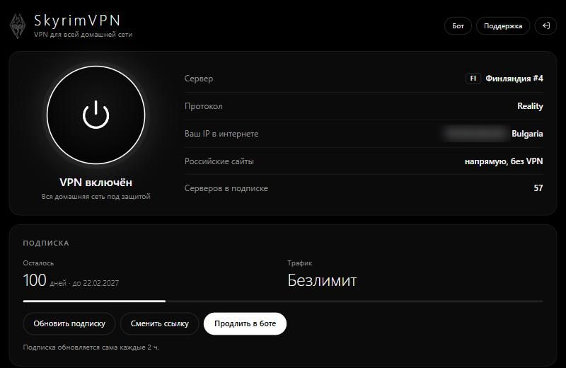
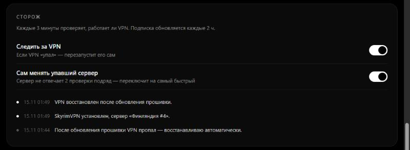
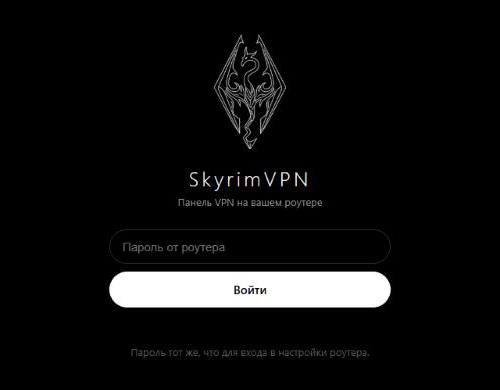
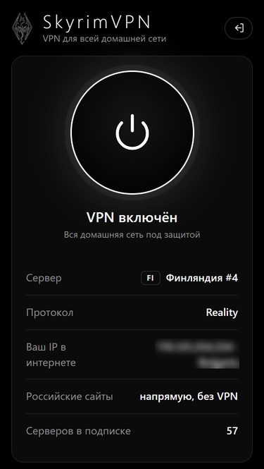

<div align="center">


# SkyrimVPN Router

**VPN для всей домашней сети: телевизор, приставка, ноутбуки и телефоны в Wi-Fi.**<br>
Ставится на роутер с OpenWrt одной командой. Российские сайты работают напрямую.

[](https://t.me/SkyrimVPN_bot)
[](https://t.me/SkyrimVPN_help_bot)
[](https://openwrt.org)
[](LICENSE)

</div>

---

## Что это и зачем

### Проблема

VPN в телефоне защищает только телефон. А дома есть телевизор, приставка, ноутбук детей, планшет, умная колонка, и на каждое устройство приложение не поставишь. На телевизоре YouTube тормозит, на приставке не открываются игры, а на ноутбуке VPN каждый раз нужно включать вручную.

### Решение

**Поставить VPN один раз на роутер.** Роутер — это коробочка, которая раздаёт дома Wi-Fi. Если VPN работает на нём, то через VPN идёт интернет **всех** устройств, подключённых к этому Wi-Fi. На самих устройствах ничего ставить и включать не нужно.

При этом **российские сайты** (Госуслуги, банки, Яндекс, ВК, всё на `.ru` и `.рф`) идут напрямую, мимо VPN, поэтому они работают как обычно.

### Что вы получите

- 🌍 **VPN на всех устройствах дома сразу:** телевизор, приставка, ноутбуки, телефоны.
- 🇷🇺 **Российские сайты без VPN:** банки и Госуслуги не будут ругаться на «иностранный IP».
- 🐉 **Свою панель SkyrimVPN** на роутере: большая кнопка включения, выбор сервера, срок подписки. На телефоне открывается как приложение.
- 🛡 **«Сторож»:** каждые 3 минуты проверяет VPN. Если сервер «упал», сам переключит на рабочий.
- 🔄 **Подписка обновляется сама:** новые серверы появляются без вашего участия.
- ♻️ **Переживает обновление прошивки роутера:** VPN восстановится сам.

### Нужно ли разбираться в сетях?

**Нет.** Если вы умеете скопировать текст и вставить его в окно, этого достаточно. Ниже всё расписано по шагам, с объяснением каждого незнакомого слова. Если где-то застрянете, напишите в [поддержку](https://t.me/SkyrimVPN_help_bot).

### Самый короткий путь

> **У вас Windows и роутер уже с OpenWrt?**
> 1. Скачайте [**SkyrimVPN-Install.bat**](https://github.com/Kochurin/SkyrimVPN-Router/raw/main/SkyrimVPN-Install.bat) и запустите двойным щелчком.
> 2. Введите пароль от роутера и вставьте ссылку на подписку из бота.
> 3. Через 5–10 минут откройте **http://192.168.1.1/skyrim**. Готово.

---

## Как это выглядит

<div align="center">
<br><br>
<br><br>
<br><br>


</div>

---

## Содержание

1. [Словарик](#словарик)
2. [Подойдёт ли мой роутер](#подойдёт-ли-мой-роутер)
3. [Установка](#установка)
   - [Способ 1. Windows: двойной щелчок](#способ-1-windows-двойной-щелчок)
   - [Способ 2. Одна команда (Windows, Mac, Linux)](#способ-2-одна-команда-windows-mac-linux)
4. [Первые шаги после установки](#первые-шаги-после-установки)
5. [Панель SkyrimVPN](#панель-skyrimvpn)
6. [Панель на телефоне как приложение](#панель-на-телефоне-как-приложение)
7. [Сторож](#сторож)
8. [Обновление](#обновление)
9. [Частые проблемы](#частые-проблемы)
10. [Вопросы новичков](#вопросы-новичков)
11. [Удаление](#удаление)
12. [Безопасность и приватность](#безопасность-и-приватность)
13. [Для разработчиков](#для-разработчиков)

---

## Словарик

| Слово | Что это простыми словами |
|---|---|
| **Роутер** | Коробочка с антеннами, которая раздаёт дома Wi-Fi. В неё входит кабель от провайдера. |
| **Прошивка** | «Операционная система» роутера, как Windows на компьютере. У каждого производителя своя. |
| **OpenWrt** | Бесплатная прошивка для роутеров, которую можно дополнять программами. SkyrimVPN ставится только на неё. |
| **Адрес роутера** | Адрес, по которому роутер открывается в браузере. У OpenWrt по умолчанию `192.168.1.1`, но его могли сменить. Как узнать свой: `Win + R` → `cmd` → команда `ipconfig` → строка **«Основной шлюз»**. В инструкции ниже везде подставляйте свой адрес вместо `192.168.1.1`. |
| **Пароль от роутера** | Пароль, с которым вы входите в настройки роутера в браузере. Он же нужен для установки. |
| **SSH** | Способ «зайти» в роутер через текстовое окно и дать ему команду. В Windows 10/11 он встроен. |
| **Командная строка** | Чёрное окно, куда вводят команды. В Windows: `Win + R` → `cmd` → Enter. |
| **Подписка** | Ваш доступ к SkyrimVPN. У неё есть **ссылка** (начинается с `https://`), её роутер и использует. |
| **Сервер** | Компьютер SkyrimVPN в другой стране, через который идёт ваш интернет. Их много, можно выбирать. |
| **Флеш** | Память роутера, куда ставятся программы (как диск у компьютера). |
| **Сторож** | Часть SkyrimVPN, которая сама проверяет VPN и чинит его. |

---

## Подойдёт ли мой роутер

| Что нужно | Минимум | Рекомендуется | Как проверить |
|---|---|---|---|
| Прошивка | **OpenWrt 24.10 или 25.12** | 24.10 или 25.12 | В браузере `192.168.1.1` → *Status → Overview* → строка **Firmware Version** |
| Оперативная память | 128 МБ | **256 МБ и больше** | Там же, строка **Memory** |
| Свободное место (флеш) | 40 МБ | **65 МБ и больше** | *System → Software*, строка «Free space» |

> [!TIP]
> **Не знаете, что у вас?** Откройте в браузере `192.168.1.1`.
> - Видите окно входа со словами **OpenWrt** или **LuCI** → у вас OpenWrt, переходите к [установке](#установка).
> - Видите фирменную страницу (TP-Link, Xiaomi, Keenetic, Huawei, Asus, логотип провайдера) → OpenWrt нет, читайте ниже.

### Если на роутере не OpenWrt

Сначала на роутер нужно поставить OpenWrt («перепрошить»). Это делается один раз.

1. Найдите на наклейке снизу роутера **модель** и **аппаратную версию** (Ver / H/W Ver).
2. Введите модель на [firmware-selector.openwrt.org](https://firmware-selector.openwrt.org). **Нет в списке — OpenWrt на этот роутер не поставить.**
3. Если модель есть, откройте её страницу в [таблице роутеров OpenWrt](https://openwrt.org/toh/start) и проверьте память: от 128 МБ оперативки и от 128 МБ флеша.
4. Прошивка — самый «опасный» шаг: ошибка может сломать роутер. Если не уверены, напишите в [поддержку](https://t.me/SkyrimVPN_help_bot), подскажем по вашей модели.

**Не подходят:** роутеры провайдеров (Ростелеком, МТС, Билайн и т.п.), большинство Huawei и Keenetic, старые модели с 8–32 МБ флеша.

**Проверенный недорогой вариант:** **Xiaomi AX3000T** (около 2500–3000 ₽, 256 МБ памяти, 128 МБ флеша). Хорошо прошивается на OpenWrt и спокойно тянет VPN. При покупке проверьте, что это именно **AX3000T**: у AX3000 и AX3000NE другая прошивка.

---

## Установка

### Перед началом

- [ ] На роутере стоит **OpenWrt** ([как проверить](#подойдёт-ли-мой-роутер)).
- [ ] Вы знаете **пароль от роутера** (с ним входите в `192.168.1.1`).
- [ ] Компьютер **подключён к этому роутеру** по Wi-Fi или кабелю.
- [ ] **VPN на компьютере выключен** (иначе компьютер не «увидит» роутер).
- [ ] В роутер вставлен кабель провайдера, и **интернет работает**.
- [ ] Ссылка на подписку скопирована: бот [@SkyrimVPN_bot](https://t.me/SkyrimVPN_bot) → **Подписка** → **Скопировать ссылку**.

> [!IMPORTANT]
> Ссылка на подписку — это ключ к вашему VPN. Никому её не показывайте и не выкладывайте в чаты.

### Способ 1. Windows: двойной щелчок

1. Скачайте файл [**SkyrimVPN-Install.bat**](https://github.com/Kochurin/SkyrimVPN-Router/raw/main/SkyrimVPN-Install.bat).
2. Запустите его двойным щелчком. Если Windows покажет синее окно «Система Windows защитила ваш компьютер», нажмите **Подробнее** → **Выполнить в любом случае**. Файл можно открыть Блокнотом и посмотреть, что внутри: там только подключение к роутеру.
3. На вопрос «Адрес роутера» нажмите **Enter** (если ваш роутер не на `192.168.1.1`, впишите его адрес).
4. Введите **пароль от роутера** и нажмите Enter. При вводе символы не видны, так и должно быть.
5. Дальше — как в шаге 4 способа 2.

### Способ 2. Одна команда (Windows, Mac, Linux)

**Шаг 1. Откройте командную строку.**
- **Windows:** нажмите `Win + R`, введите `cmd`, нажмите Enter.
- **Mac:** Launchpad → «Терминал».

**Шаг 2. Подключитесь к роутеру.** Введите и нажмите Enter:

```bash
ssh root@192.168.1.1
```

- Если спросит `Are you sure you want to continue connecting (yes/no)?` — напишите `yes` и нажмите Enter.
- Введите пароль от роутера (символы не видны) и нажмите Enter.
- Должна появиться надпись **OpenWrt** и строка вида `root@OpenWrt:~#`. Значит, вы внутри роутера.

**Шаг 3. Вставьте команду установки** (правой кнопкой мыши в окне) и нажмите Enter:

```bash
sh <(wget -qO- https://kochurin.github.io/SkyrimVPN-Router/i)
```

<details>
<summary>Если эта команда не сработала</summary>

Та же установка через другие адреса:

```bash
sh <(wget -qO- https://raw.githubusercontent.com/Kochurin/SkyrimVPN-Router/main/i)
```

```bash
sh <(wget -qO- https://cdn.jsdelivr.net/gh/Kochurin/SkyrimVPN-Router@main/i)
```

</details>

**Шаг 4. Ответьте на два вопроса.** Скрипт всё сделает сам и спросит только:

1. **«Вставьте ссылку на подписку»** → вставьте ссылку из бота, нажмите Enter.
2. **«Номер сервера»** → просто нажмите **Enter**, скрипт сам найдёт самый быстрый.

**Шаг 5. Дождитесь «Готово!».** Установка занимает 5–10 минут. Роутер может «задуматься» на минуту-другую, это нормально, ничего не нажимайте. В конце вы увидите:

```
✔ VPN работает. Внешний IP: … (Netherlands)
✔ Госуслуги открываются напрямую — российские сайты идут мимо VPN.

Готово! VPN работает для всех устройств, подключённых к роутеру.
```

### Что делает установщик

| Шаг | Что происходит |
|---|---|
| 1. Проверка | Версия OpenWrt, память, место, часы роутера, интернет и DNS. Если чего-то не хватает, скрипт остановится **до** любых изменений и объяснит, что не так. |
| 2. Репозиторий | Подключает официальный репозиторий [PassWall](https://github.com/xiaorouji/openwrt-passwall2) (с проверкой подписи). При сбоях повторяет до 3 раз. |
| 3. DNS | Меняет `dnsmasq` на `dnsmasq-full` так, чтобы роутер ни на секунду не остался без интернета. |
| 4. Программы | Ставит PassWall 2, ядро Xray (VLESS/REALITY, Hysteria2) и русский перевод. |
| 5. Экономия места | Из базы адресов оставляет только Россию: освобождает ~16 МБ флеша. |
| 6. Панель | Ставит панель `http://192.168.1.1/skyrim`, пункт **SkyrimVPN** в меню роутера и команду `skyrim`. |
| 7. Сторож | Включает проверку VPN каждые 3 минуты и восстановление после обновления прошивки. |
| 8. Подписка | Загружает серверы, включает автообновление (как советует сервер подписки, сейчас раз в 2 часа). |
| 9. Сервер | Проверяет быстрые серверы и включает самый быстрый. |
| 10. Маршруты | Российские сайты и адреса идут напрямую, остальное через VPN. |
| 11. Проверка | Убеждается, что YouTube работает через VPN, а Госуслуги напрямую. |

---

## Первые шаги после установки

1. **Откройте панель:** [http://192.168.1.1/skyrim](http://192.168.1.1/skyrim) и войдите с паролем от роутера.
2. **Посмотрите на большую кнопку:** она должна светиться белым и показывать «VPN включён».
3. **Проверьте на телефоне:** подключитесь к Wi-Fi роутера и откройте YouTube или Instagram. VPN на самом телефоне при этом не нужен.
4. **Проверьте российский сайт:** откройте Госуслуги или банк, они должны работать как обычно.
5. **Добавьте панель на экран телефона** ([как](#панель-на-телефоне-как-приложение)), чтобы заходить в один тап.
6. **Задайте пароль от роутера**, если его нет: `192.168.1.1` → *System → Administration*. Без пароля любой в вашем Wi-Fi может управлять роутером.

Всё, больше ничего делать не нужно. Подписка обновляется сама, «Сторож» следит за VPN.

---

## Панель SkyrimVPN

Адрес: **http://192.168.1.1/skyrim**. Пароль тот же, что от роутера. Панель есть и в обычном меню роутера: пункт **SkyrimVPN** вверху.

| Раздел | Что там |
|---|---|
| **Большая кнопка** | Включить / выключить VPN. Белая — VPN работает. Серая — выключен. Красная — включён, но не работает: нажмите, чтобы перезапустить. |
| **Статус** | Текущий сервер, протокол, ваш IP и страна в интернете. |
| **Подписка** | Сколько дней осталось и до какого числа, трафик. Кнопки «Обновить подписку», «Сменить ссылку», «Продлить в боте». |
| **Серверы** | Все серверы подписки. Нажмите на сервер, чтобы переключиться. «Проверить скорость» измерит отклик, «Подобрать быстрый» выберет лучший сам. |
| **Сторож** | Переключатели «Следить за VPN» и «Сам менять упавший сервер», журнал событий. |
| **Внизу** | «Отчёт для поддержки», «Расширенные настройки» (PassWall 2), «Настройки роутера». |

**Метки у серверов:**

| Метка | Значение |
|---|---|
| **Быстрые** (⚡) | Самые быстрые серверы. Для дома берите их, автоподбор так и делает. |
| **Gemini** (⭐) | На сервере работает Gemini. |
| **Мобильные** (📱) | Для мобильного интернета с белыми списками. На домашнем интернете преимуществ не дают. |
| **Игровые** (🎮, Hysteria2) | Меньше задержка в играх. |
| **Торренты** | На сервере разрешены торренты. |

---

## Панель на телефоне как приложение

Телефон должен быть подключён к Wi-Fi роутера.

- **iPhone:** откройте `192.168.1.1/skyrim` в **Safari** → кнопка «Поделиться» (квадрат со стрелкой) → **«На экран Домой»** → «Добавить».
- **Android:** откройте `192.168.1.1/skyrim` в **Chrome** → меню **⋮** → **«Добавить на главный экран»**.

На экране появится иконка с драконом SkyrimVPN. Панель будет открываться по ней в один тап. Вход сохраняется на неделю (после перезагрузки роутера нужно войти заново).

---

## Сторож

«Сторож» каждые 3 минуты проверяет, работает ли VPN, и сам чинит частые поломки:

| Что случилось | Что сделает Сторож |
|---|---|
| VPN «упал» (программа остановилась) | Перезапустит его. |
| Сервер не отвечает 2 проверки подряд | Найдёт самый быстрый рабочий сервер и переключится на него. |
| Пропал интернет у провайдера | Ничего не тронет: дело не в VPN. Запишет в журнал и будет ждать. |
| Обновили прошивку роутера | После перезагрузки сам поставит всё заново с вашей подпиской. |

Всё, что делает Сторож, видно в панели в разделе **«Сторож»**, например: *«Сервер «Германия #3» не отвечал — переключил на «Финляндия #4»»*.

Если вы хотите, чтобы сервер всегда оставался одним и тем же, выключите **«Сам менять упавший сервер»**. Тогда Сторож будет только сообщать о проблемах.

---

## Обновление

**SkyrimVPN** (скрипт и панель):

```bash
skyrim panel
```

или в меню `skyrim` → «Обновить скрипт и веб-панель». Настройки, подписка и выбранный сервер сохраняются.

**Прошивка роутера (OpenWrt).** При обновлении прошивки роутер стирает все дополнительные программы, включая VPN. Если при обновлении оставлена галочка **«Keep settings» / «Сохранить настройки»** (так по умолчанию), SkyrimVPN **восстановится сам** через 5–15 минут после перезагрузки: Сторож заметит, что программ нет, и поставит их заново с вашей подпиской. Если вы обновлялись без сохранения настроек, просто [установите заново](#установка).

---

## Частые проблемы

| Что видите | Что сделать |
|---|---|
| `ssh` пишет **Connection refused / timed out** | Компьютер не подключён к роутеру, неверный адрес или на роутере не OpenWrt. Проверьте Wi-Fi и откройте `192.168.1.1` в браузере. |
| `ssh` пишет **REMOTE HOST IDENTIFICATION HAS CHANGED** | Роутер перепрошивали. Выполните `ssh-keygen -R 192.168.1.1` и подключитесь снова. |
| `ssh` пишет **Permission denied** | Неверный пароль от роутера. Это пароль от `192.168.1.1`, не от Wi-Fi. |
| Установщик: **«Мало места на флеше»** | Удалите лишние программы (*System → Software*) или используйте роутер побольше. |
| Установщик: **«Мало оперативной памяти»** | Роутер слишком слабый для VPN. Нужен роутер от 128 МБ, лучше 256 МБ. |
| Установщик: **«Сервер пакетов не отвечает»** | Временный сбой. Подождите 5–10 минут и запустите команду снова. |
| Установщик: **«Серверы не загрузились»** | Подписка закончилась, ссылка скопирована не полностью или занят лимит устройств. Проверьте в боте. |
| Установщик: **«неверные часы» / «не работает DNS»** | *System → System → Sync with NTP-Server*, перезагрузите роутер, запустите снова. |
| Кнопка в панели **красная** | VPN включён, но не работает. Нажмите на кнопку (перезапуск) или выберите другой сервер. |
| Сайты **не открываются** через VPN | Выберите другой сервер или нажмите «Подобрать быстрый». |
| **Не открывается банк или Госуслуги** | Сайты на `.ru` / `.рф` и российские адреса идут напрямую. Если какой-то сайт всё же не открывается, нажмите «Отчёт для поддержки» и напишите нам, какой сайт. |
| **YouTube на телевизоре** всё равно тормозит | Перезагрузите телевизор (он мог запомнить старый маршрут). Проверьте, что телевизор в Wi-Fi именно этого роутера. |
| Панель **не открывается** | Проверьте, что вы в Wi-Fi этого роутера. Адрес роутера мог быть изменён: точную ссылку на панель установщик пишет в самом конце, а адрес роутера показывает `ipconfig` → «Основной шлюз» (см. [Словарик](#словарик)). Откройте `http://<адрес>/skyrim`. |
| **Забыли пароль** от роутера | Сбросьте роутер кнопкой Reset (настройки сотрутся, VPN нужно будет поставить заново). |

Не нашли свою проблему? Нажмите в панели внизу **«Отчёт для поддержки»** (или в консоли `skyrim report`) и отправьте его в [поддержку](https://t.me/SkyrimVPN_help_bot). В отчёте нет ссылки на подписку и IP-адресов, его безопасно пересылать.

---

## Вопросы новичков

<details>
<summary><b>Я ничего не сломаю?</b></summary>

Установщик сначала всё проверяет и ничего не меняет, если роутер не подходит. Настройки интернета и Wi-Fi он не трогает. В любой момент можно выключить VPN кнопкой или [удалить всё](#удаление) одной командой. Роутер вернётся к исходному виду.
</details>

<details>
<summary><b>Сколько устройств из подписки займёт роутер?</b></summary>

Одно. Роутер сообщает серверу свой «отпечаток» (как приложение), и все устройства дома идут через это одно место.
</details>

<details>
<summary><b>Нужно ли включать VPN на телефоне дома?</b></summary>

Нет. Дома, в Wi-Fi роутера, телефон уже идёт через VPN роутера. Приложение в телефоне нужно, когда вы вне дома, на мобильном интернете.
</details>

<details>
<summary><b>Почему сайты показывают другую страну, а не ту, что в названии сервера?</b></summary>

Часть серверов выходит в интернет через соседнюю страну. На работу VPN это не влияет.
</details>

<details>
<summary><b>Скорость интернета упадёт?</b></summary>

Немного, как и с любым VPN. Сильнее всего это зависит от процессора роутера: чем новее роутер, тем меньше потеря. Российские сайты идут напрямую, их скорость не меняется.
</details>

<details>
<summary><b>Что будет, когда закончится подписка?</b></summary>

VPN перестанет подключаться, а российские сайты продолжат работать. Продлите подписку в боте, и через несколько минут всё заработает само (или нажмите в панели «Обновить подписку»).
</details>

<details>
<summary><b>Можно выключить VPN на время?</b></summary>

Да, большой кнопкой в панели. Интернет пойдёт напрямую. Включается той же кнопкой.
</details>

<details>
<summary><b>Работает ли с играми и торрентами?</b></summary>

Для игр есть «Игровые» серверы (Hysteria2) с меньшей задержкой. Торренты разрешены на серверах с меткой «Торренты».
</details>

---

## Удаление

В консоли роутера:

```bash
skyrim remove
```

Или `skyrim` → «Удалить SkyrimVPN». Удаляются панель, Сторож, PassWall 2, Xray и их настройки. Скрипт предложит вернуть обычный `dnsmasq`. Интернет пойдёт напрямую, как до установки.

---

## Безопасность и приватность

- **Никакой статистики и слежки.** Роутер обращается только к GitHub (установка и обновление), официальному репозиторию PassWall, вашему серверу подписки и серверам SkyrimVPN.
- **Панель доступна только из домашней сети** и защищена паролем от роутера. Не открывайте её в интернет.
- **Ссылка на подписку** хранится только на вашем роутере. В отчёт для поддержки она не попадает.
- **Весь код открыт** в этом репозитории, его может проверить любой.

---

## Для разработчиков

| Файл | Что это |
|---|---|
| [`skyrim.sh`](skyrim.sh) | Установщик, консольное меню, Сторож (POSIX sh, BusyBox ash) |
| [`i`](i) | Короткий загрузчик: скачивает `skyrim.sh` с первого доступного зеркала |
| [`SkyrimVPN-Install.bat`](SkyrimVPN-Install.bat) | Установка с Windows двойным щелчком (встроенный OpenSSH) |
| [`panel/web/`](panel/web) | Панель `/skyrim/`: страница, логика, иконки, manifest для «приложения» |
| [`panel/rpcd.sh`](panel/rpcd.sh) | Серверная часть панели (rpcd-плагин, ubus-объект `skyrimvpn`), вход через `session.login` |
| [`panel/skyrimvpn.js`](panel/skyrimvpn.js), [`menu.json`](panel/menu.json), [`acl.json`](panel/acl.json) | Пункт меню и права в LuCI |

**Команды:** `skyrim [install|server|update|on|off|status|report|events|panel|remove]`.
**Настройки:** `/etc/config/skyrim` (`watchdog`, `autoswitch`, `restore`, `sub_hours`).
**Сторож:** cron каждые 3 минуты (`skyrim watchdog`), журнал `/tmp/skyrim-events.log`.
**После перепрошивки:** `/usr/bin/skyrim` сохраняется через `/etc/sysupgrade.conf`, восстановление запускается из `/etc/rc.local` (`skyrim boot`).

Проверено с нуля на OpenWrt **24.10.8** (x86_64 и ARM Cortex-A53 / 256 МБ) и **25.12.6** в QEMU: установка, панель, Сторож, обновление прошивки с сохранением настроек, удаление.

---

<div align="center">

**SkyrimVPN** · [Бот](https://t.me/SkyrimVPN_bot) · [Поддержка](https://t.me/SkyrimVPN_help_bot) · [Сайт](https://skyrim.connecto.lol) · [Канал](https://t.me/skyrimVPN)

</div>
